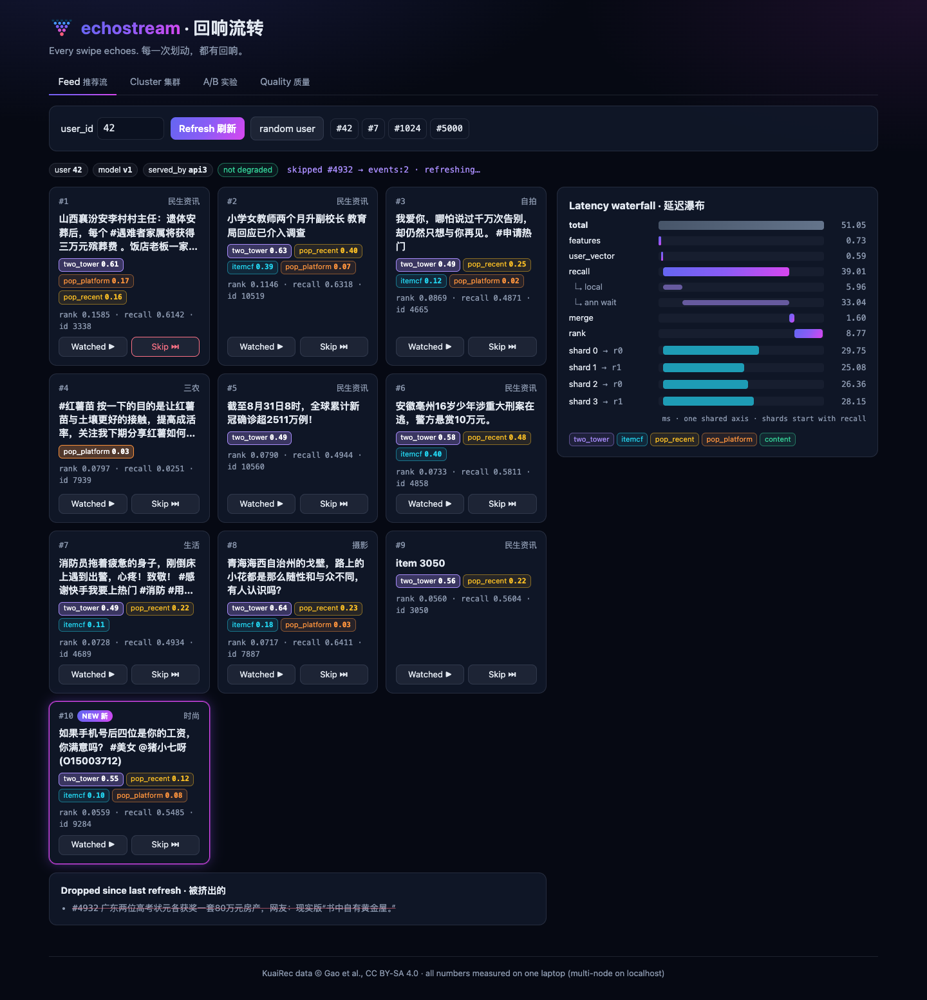
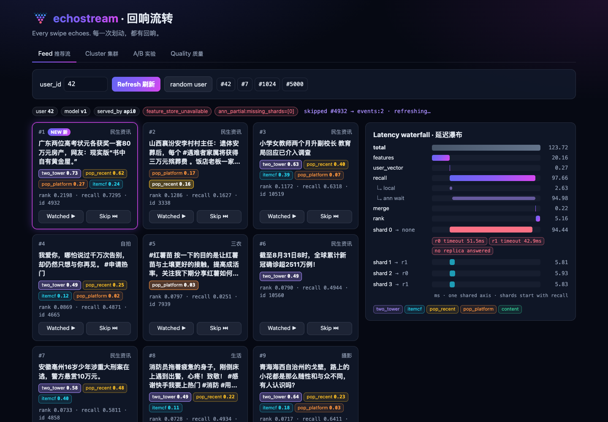
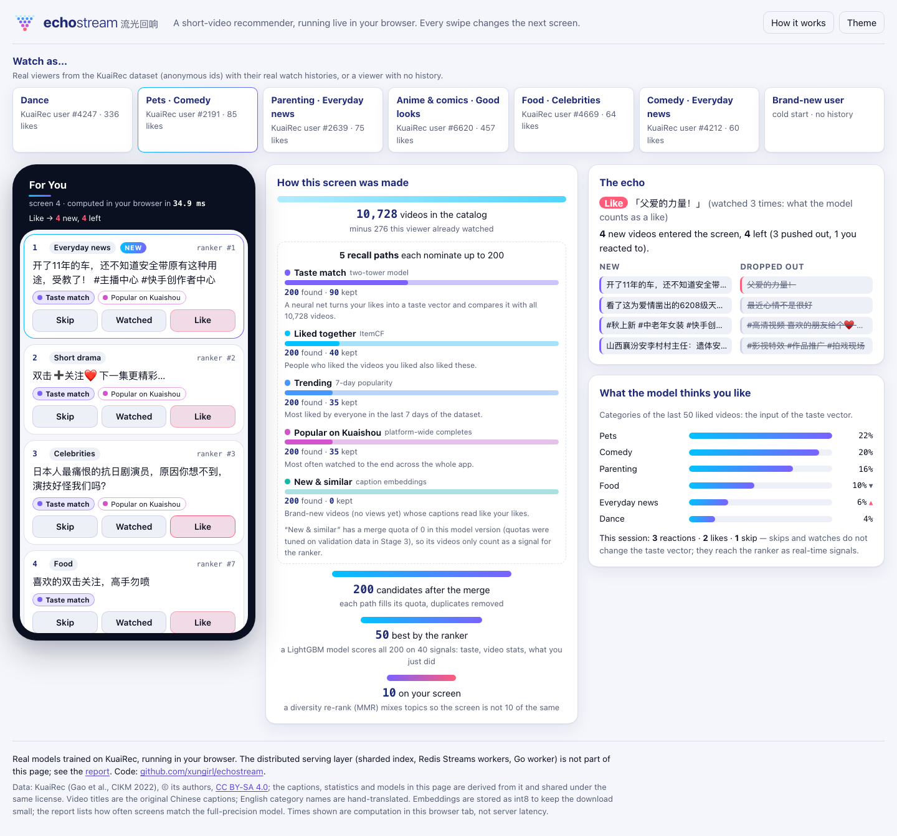
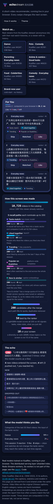

<p align="center"><picture><source media="(prefers-color-scheme: dark)" srcset="docs/brand/svg/lockup-bilingual-on-dark.svg"></picture></p>

<p align="center">
  <b>Every swipe echoes.</b><br/>
  每一次划动，都有回响。
</p>

<p align="center">
  A distributed short-video recommender driven by real-time user feedback.<br/>
  基于实时行为反馈的分布式短视频推荐系统
</p>

<p align="center">
  <b>▶ Try it in your browser: <a href="https://xungirl.com/echostream/demo/">xungirl.com/echostream/demo</a></b><br/>
  the real trained models, running in your tab: react to videos and watch the next screen change · 在浏览器里直接体验
</p>

---

## What is this? · 这是什么

**English**
echostream is a scaled-down replica of the architecture behind a Douyin / TikTok-style "For You" feed. It is a backend service, not a mobile app. A client asks "what should user 42 see next?" and gets a ranked list back within a strict latency budget. When the user watches or skips a video, that event flows back through the system and changes the very next recommendation. That loop is the echo.

It runs on **KuaiRec**, a real short-video interaction dataset released by Kuaishou, not synthetic data. Every number in this repo comes from a run on real hardware, and each one is labeled as either a quality result or a systems test.

**中文**
流光回响是抖音、TikTok「推荐页」背后架构的缩小版。它是一个后端服务，不是手机 App。客户端问「用户 42 下一屏该看什么」，它在严格的延迟预算内返回一个排好序的推荐列表。用户看完或划走一个视频，这个行为会流回系统，马上改变下一次推荐。这个闭环就是「回响」。

数据用的是快手公开的真实短视频数据集 **KuaiRec**，不是模拟数据。仓库里每个数字都来自真实运行，并且标明它是推荐质量结果，还是系统测试结果。

---

## Screenshots · 截图

| live feed after a skip | chaos: shard 0 slow on both replicas + feature node frozen |
|---|---|
|  |  |

| browser demo (Stage 13): three reactions later, the real models running in the tab | the same page at 375 px, dark |
|---|---|
|  |  |

## How a request flows · 一次请求怎么走

```
  client                         echostream
 ┌────────┐  GET /recommend   ┌──────────────────────────────────────────────┐
 │  feed  │ ────────────────▶ │  API (stateless, replicated)                 │
 │        │                   │   ├─ recall (parallel, per-path timeouts)    │
 │        │                   │   │    two-tower ANN ── scatter-gather ──▶ index shards (+replicas)
 │        │                   │   │    ItemCF · trending · cold-start content │
 │        │                   │   ├─ features ◀── sharded real-time store    │
 │        │                   │   ├─ rank   (LightGBM)                       │
 │        │ ◀──────────────── │   └─ re-rank (MMR diversity)                 │
 │        │   items + timings │                                              │
 │        │                   │                                              │
 │        │  POST /events     │  Redis Streams (partitioned by user)         │
 │ watch/ │ ────────────────▶ │   └─ consumer group workers ── update ──▶ real-time features
 │  skip  │                   │      (at-least-once · idempotent · DLQ)      │
 └────────┘                   └──────────────────────────────────────────────┘
                                 offline: train · evaluate · regression gate · canary
```

**English**: recall → rank → re-rank on the read path; events → stream → real-time features on the write path. The two paths meet in the feature store, which is what makes the next swipe different.

**中文**：读路径是「召回 → 排序 → 重排」，写路径是「事件 → 事件流 → 实时特征」。两条路径在特征存储里交汇，所以下一屏会变。

---

## What's inside · 包含什么

| Layer · 层 | English | 中文 |
|---|---|---|
| Evaluation | Time-based split, Recall@K / NDCG@K, popularity · ItemCF · ALS baselines, bootstrap CIs | 按时间切分、Recall@K / NDCG@K、热门 / ItemCF / ALS 基线、自助法置信区间 |
| Recall | Two-tower model with logQ correction + ANN, ItemCF, trending, cold-start from captions | 带 logQ 修正的双塔 + 向量检索、ItemCF、热门、基于标题的冷启动 |
| Ranking | LightGBM over user, item, affinity and real-time features | LightGBM，用用户、视频、兴趣匹配和实时特征 |
| Re-ranking | MMR for diversity | MMR 多样性重排 |
| Distributed serving | Sharded vector index with replicas, scatter-gather with deadlines, partitioned event stream, sharded feature store, graceful degradation | 带副本的向量索引分片、带截止时间的并行查询合并、分区事件流、分片特征存储、逐级降级 |
| Release safety | Shadow → canary → automatic rollback, eval regression gate | 影子运行 → 灰度 → 自动回滚，评测回归门禁 |
| Agent | A tool-using agent that investigates gate failures and writes incident reports | 门禁触发时自动排查原因、写事故报告的 agent |
| Experiments | Simulated online A/B on the fully-observed matrix | 在全观测矩阵上做模拟线上 A/B |
| Demo | Web feed with live per-stage latency waterfall | 网页推荐流 demo，实时显示每个阶段的耗时 |
| Browser demo | The trained models exported to a static bundle and the read path re-implemented in TypeScript; public page, no backend; golden parity test vs Python | 模型导出成静态包、读路径用 TypeScript 重写，公开网页无后端；与 Python 逐屏对拍 |
| Go worker | Drop-in Go rewrite of the stream consumer: same leases / XAUTOCLAIM / dedupe / DLQ, identical output (parity test), 2× end-to-end throughput, ~1/6 of the CPU | 用 Go 重写的事件消费者：租约、接管、去重、死信完全一致（对拍测试），端到端吞吐 2 倍、CPU 约 1/6 |

---

## Honest scope · 诚实说明

**English**
- Everything runs as **multiple nodes on one laptop** (localhost). Fault tolerance, tail latency and event reliability are tested for real; horizontal throughput scaling is not claimed.
- KuaiRec is small (~10K videos). Recommendation quality is measured on real data only. Systems tests use either **real event replay** or clearly labeled **synthetic scale-up**.
- KuaiRec has no video files, so the demo shows video cards (caption, category), not playback.

**中文**
- 所有组件都是**在一台笔记本上运行的多个节点**（localhost）。容错、尾延迟和事件可靠性是真实测出来的；不声称吞吐能随机器数量线性扩展。
- KuaiRec 规模不大（约 1 万个视频）。推荐质量只在真实数据上评测；系统测试要么用**真实事件重放**，要么用明确标注的**合成扩容**数据。
- KuaiRec 没有视频文件，所以 demo 显示的是视频卡片（标题、分类），不能播放。

---

## Roadmap · 路线图

- [x] Stage 0 · Data & labels · 数据与标签定义
- [x] Stage 1 · Offline evaluation & baselines · 离线评测与基线
- [x] Stage 2 · Two-tower retrieval + ANN · 双塔召回 + 向量检索
- [x] Stage 3 · Multi-path recall & cold start · 多路召回与冷启动
- [x] Stage 4 · Ranking · 排序
- [x] Stage 5 · Distributed serving, load & chaos tests · 分布式服务、压测与故障注入 — **MVP**
- [x] Stage 6 · MMR re-ranking · MMR 重排
- [x] Stage 7 · Simulated online A/B (pre-registered) · 模拟线上 A/B（预注册）
- [x] Stage 8 · Postgres, caching, shadow / canary / rollback · Postgres、缓存、影子 / 灰度 / 回滚
- [x] Stage 9 · Release-guard agent · 发布守门 agent
- [x] Stage 10 · Web demo · 网页 demo
- [x] Stage 12 · Event worker rewritten in Go, parity-tested, now the default · 用 Go 重写事件 worker（逐字节对齐，已设为默认）
- [x] Stage 13 · Serverless browser demo: the read path in TypeScript, golden-tested against Python · 浏览器里跑真模型的公开 demo（与 Python 对拍）
- [ ] Next · E-commerce domain adapter (Amazon Reviews 2023) · 电商领域适配器

---

## Project Journey · 项目历程

Each stage: goal → decision & alternatives → built → verified → measured → problems/fixes. Numbers are copied from the
`results/` file named next to them (BENCHMARK.md has the exact commands). 每个阶段下面有一段中文小结。

### Stage 0 — Data & labels
- **Goal:** get KuaiRec, verify every assumption, define "liked" without a like signal.
- **Decision & alternatives:** positive = `watch_ratio > 2.0` (dataset authors' suggestion). `>1.0` marks 33.8% of plays positive
  (mostly "short video looped once"); `>3.0` drops evaluable test users from 6,607 to 5,344. Sensitivity kept in DATA.md.
- **Built:** `make data` (Zenodo download, SHA-256 for the zip and all 7 CSVs, parquet), `DomainAdapter` interface + KuaiRec adapter.
- **Verified / measured:** 12,530,806 big-matrix rows, 7,176 users × 10,728 videos, density 0.163; small matrix 99.62% observed;
  0 (user, video) pairs shared between the two matrices.
- **Problems → fixes:** the big matrix is three date windows, not one continuous log; **86.3%** of test-window positives are
  videos absent from the train window (catalog drift) → test-phase models are refit on all data before Sep 1, tuning stays on val.
  The label is biased toward short videos (positive rate 18.1% for <7 s vs 0.2% for >60 s) — documented, not hidden.
- 中文：数据下载校验、正样本定义（watch_ratio>2）和敏感性；发现三段日期窗口和严重的目录漂移，改成「val 调参、test 前用全部历史重训」。

### Stage 1 — Offline evaluation & baselines
- **Goal:** a leak-free yardstick before any model.
- **Decision:** temporal split by logged date; metrics Recall/NDCG/HitRate/MRR @ {10, 50, 100, 200}, coverage, category diversity,
  95% bootstrap CIs over users; a second, exposure-bias-free evaluation on the fully-observed small matrix.
- **Built:** `core/metrics.py`, `core/split.py`, hand-written ItemCF, popularity (3 kinds), ALS.
- **Measured (quality, `results/stage1_baselines.json`):** best test NDCG@10 = recent popularity 0.0430 [0.0410, 0.0451];
  ItemCF 0.0181, ALS 0.0162. On the small matrix the order flips: ItemCF 0.618, global popularity 0.561.
- **Lesson:** which baseline "wins" depends on exposure bias and catalog drift; both evaluations are kept.
- 中文：时间切分 + 自助法置信区间；近期热门在时间切分上最强，全观测小矩阵上 ItemCF 最强——评测方式会改变结论。

### Stage 2 — Two-tower retrieval + ANN
- **Goal:** personalized retrieval that scales.
- **Decision & alternatives:** in-batch sampled softmax with logQ correction; ablated logQ and 1,024 mixed uniform negatives;
  temperature tuned on val (0.1). Item tower = id + categories + bge-small-zh caption embedding, with 30% id-dropout for cold items.
  User tower exported to numpy so serving does not need PyTorch.
- **Measured (quality, `results/stage2_two_tower.json`):** test NDCG@10 **0.0803** [0.0775, 0.0831], +0.0372 [0.0349, 0.0397]
  over the best baseline (paired). Without logQ and mixed negatives: 0.0071. Seed std 0.0018.
- **ANN (`results/stage2_ann.json`):** on the real 10,728 vectors exact Flat search is 92 µs p50 (1 thread); HNSW M=32/ef=128
  reaches recall@100 0.955 at 47.5 µs. → serving uses exact Flat shards; ANN trade-offs are shown at synthetic scale (Stage 5).
- **Problems → fixes:** faiss, torch, LightGBM and implicit each bundle `libomp`; loading torch with any of the others in one
  process aborts on macOS → rule "torch never shares a process with them", training runs in subprocesses.
- 中文：带 logQ 的双塔把 NDCG@10 从 0.043 提到 0.080；去掉 logQ 掉到 0.007。1 万级向量精确检索只要 0.09 ms，所以分片用精确索引。

### Stage 3 — Multi-path recall & cold start
- **Goal:** candidates that cover personalization, trends and brand-new videos.
- **Built:** five paths (two-tower, ItemCF, recent popularity, platform popularity, caption-content restricted to cold videos),
  quota merge with dedup that remembers every path that proposed an item.
- **Measured (`results/stage3_multipath.json`):** val-selected quotas give merged recall@200 0.233 on test — *lower* than two-tower
  alone (0.271), because on val (catalog drift) the two-tower was weak and the mix looked better. The content path finds 21.3% of
  the cold-video truth but got quota 0. Not re-tuned on test.
- 中文：多路召回的配额在 val 上选；test 上反而不如双塔单路——如实记录，没有在 test 上重调。

### Stage 4 — Ranking
- **Goal:** order ~200 candidates well.
- **Built:** one feature builder shared by offline training and the online API (40 features in 5 groups), LightGBM, AUC/GAUC.
- **Problem → fix:** v1 trained on the val phase *lost* to recall-only ordering on test (NDCG@10 0.0696 vs 0.0803): its two-tower
  score feature came from a model 3 weeks stale relative to its labels, unlike at serving time (train/serve skew). v2 trains on a
  "rank phase" whose recall models are refit right before the labels (08-30…31). This protocol was designed **after** seeing v1's
  test result; both runs are kept.
- **Measured (`results/stage4_ranker.json`):** recall+rank NDCG@10 **0.1100** [0.1064, 0.1136], +0.0297 [0.0267, 0.0325] over
  recall-only; AUC 0.861, GAUC 0.813. Every feature group helps (item features most: −0.0415 when removed).
- 中文：排序第一版因为训练阶段的召回分数分布和线上不一致而变差；改训练协议后 NDCG@10 0.110（+0.030）。

### Stage 5 — Distributed serving core (MVP)
- **Goal:** serve the Stage-4 pipeline with the mechanisms a real feed backend needs, and measure them under failure.
- **Decisions & alternatives:** a ~400-line process supervisor instead of docker compose (ms-level kill/freeze/delay from
  tests, no VM network inside latency numbers); nginx as the load balancer (retries the other replica on connect errors);
  Redis Streams with **leased partitions** (one owner per partition → per-user order) instead of a plain consumer group
  (which would interleave a user's events across workers); a Lua script that does dedupe + apply atomically on the user's
  feature node (exactly-once effect over at-least-once delivery); exact Flat shards (offline == online, tested).
- **Built:** shard servers (+ replicas, delay/stale hooks, deadline header), scatter-gather client with per-attempt timeouts,
  replica failover and outlier ejection, `/recommend` with a 250 ms budget and labeled degradation, `/events`, workers,
  sharded feature store, Prometheus metrics, open-loop load generator, chaos runner, replay runner, synthetic scale runner.
- **Verified:** integration tests (`tests/integration/`) — no loss / no double count / per-user order with duplicate sends, DLQ, XAUTOCLAIM
  takeover of a dead consumer's 600 pending entries, feature-node stall, online ANN == offline exact search, an event changes
  the next recommendation, shard/replica/API failures, ranker timeout and budget fallbacks.
- **Measured:**
  - *systems* (`results/stage5_load.json`): 200 rps → p50 12.1 ms, p99 26.3 ms, 0 errors; 250 rps saturates the laptop.
  - *systems* (`results/stage5_chaos.json`): 100% availability in all 15 fault runs (kill shard primary, slow shard +500 ms,
    kill worker, stall a feature node, kill an API replica; 3 repeats each); a stalled feature node degrades the ~1/3 of
    users it owns (33–37% of responses carry `feature_store_unavailable`) instead of failing them.
  - *real-replay* (`results/stage5_replay_full.json`): all 12,530,806 KuaiRec events in time order through
    nginx → API → streams → workers → feature store at **37,221 events/s**; **0** of 7,176 users with a counter mismatch,
    0 duplicates, 0 DLQ. Paced at 10k events/s: event → feature latency p99 ≤ 50 ms (`stage5_replay_paced10k.json`).
  - *synthetic* (`results/stage5_synthetic.json`): 1M–10M random vectors over 1–8 shards: per-shard memory drops linearly (10M IVF: 2.5 GB → 315 MB of vectors per shard), but p50 latency does not improve on one laptop (2.3 → 6.0 ms from 1 to 8 shards: fan-out RPC cost dominates).
- **Problems → fixes:** per-request CPU (≈5 ms, 2.4 ms of it LightGBM) capped 2 API replicas at ~150 rps → binary (base64)
  shard payloads, uvloop/httptools, 4 replicas. A worker started while Redis was still loading its AOF died silently and
  sat idle → startup retry + exit-on-crash so the supervisor restarts it; benchmarks now start from a fresh data dir.
  The first chaos summary used per-second p99 for "recovery", which at 100 rps is a single request → added a p50-based rule
  (both kept).
- 中文：自写进程管理器 + nginx + 分片向量检索（副本、超时、摘除）+ 分区事件流（租约保证用户内有序、Lua 幂等）+ 分片特征库。
  200 rps 下 p99 26 ms；15 次故障注入全部 100% 可用；1,253 万条真实事件重放 3.7 万条/秒、逐用户计数零误差。

### Stage 6 — MMR re-ranking
- **Goal:** less repetitive pages without paying in relevance.
- **Decision:** MMR over the ranker's top-50, similarity = mean(category Jaccard, caption cosine); λ chosen by a rule written
  before the sweep: the most diverse λ whose NDCG@10 drop vs λ = 1 is not significant (paired CI contains 0).
- **Measured (quality, `results/stage6_mmr.json`):** λ = 0.7 → NDCG@10 0.1099 vs 0.1100 (Δ −0.0001, CI contains 0),
  category diversity@10 **0.746 → 0.896**, coverage@10 0.0355 → 0.0390. Below λ = 0.6 relevance falls (λ = 0.3: −0.0148).
- 中文：MMR 在 λ=0.7 时类别多样性从 0.746 提到 0.896，NDCG@10 基本不变（差值 CI 含 0）。

### Stage 7 — Simulated online A/B (pre-registered)
- **Goal:** check whether offline wins survive a setting with session dynamics and no exposure bias.
- **Decision:** `PREREG.md` (hypotheses, variants, metric, analysis, stopping rule) was committed before the run. The simulator
  shows 5 slates × 10 videos to each of the 1,411 fully-observed users; the response is the user's true watch_ratio; positives
  update the history between slates. Assignment by consistent-hash buckets (20 per variant).
- **Measured (quality/simulated, `results/stage7_ab.json`):** positives per impression (within-subjects, 95% CI):
  popularity 0.158 · ALS **0.214** · two-tower **0.213** · recall+rank 0.179 · recall+rank+MMR 0.180.
  Between-subjects A/B (~280 users/arm, Holm-corrected): only ALS > popularity (+0.066) is significant; rank − two-tower =
  −0.021 [−0.043, +0.001] (H1 not supported). Within-subjects the ranker is significantly *worse* than the two-tower
  (−0.034 [−0.037, −0.030]); MMR is +0.0013 [0.0004, 0.0021] over rank.
- **Offline vs online:** big-matrix test NDCG@10 orders the variants with Kendall τ = **−0.4** against the simulated online
  order (7 of 10 pairs disagree); the small matrix's own single-slate NDCG@10 agrees much better (τ = +0.6).
- **Interpretation (hypothesis, not proven):** the ranker learned "what the platform will expose *and* the user will like"
  (item exposure/popularity features dominate its importance) — a big win on the exposure-biased log, a loss for users who
  saw everything. No deviations from the pre-registration.
- 中文：预注册的模拟 A/B 推翻了「排序一定更好」：在无曝光偏差的全观测用户上，排序比双塔差；离线大矩阵排名和模拟线上排名
  Kendall τ = −0.4。这是离线-线上不一致的真实案例。

### Stage 8 — Postgres, caching, safe rollout
- **Goal:** one source of truth, and model releases that cannot take the feed down.
- **Decisions:** Postgres holds users, videos, the model registry, rollout state, experiment config and an event archive
  (workers write it in batches *before* acking); Redis holds only derived data and can be rebuilt
  (`python -m echostream.store.rebuild`). Every API replica and shard reconciles once per second to the desired rollout row
  (hot bundle load, no restarts). Rollout = register → shadow (new model scores every request off the response path) →
  canary (10% of users by consistent hash; the live cluster is driven by simulated small-matrix users) → promote, or
  automatic rollback on error rate, p99 > max(50 ms, 2× control), degraded share +5 pp, or a significantly worse online metric.
- **Measured (`results/stage8_rollout.json`; systems + simulated online):**
  - v2 (two-tower refresh, new seed): shadow overlap@10 0.69 → canary diff CI [−0.069, +0.044] → **promoted**.
  - v3-slow (2,000-tree × 255-leaf ranker, fine offline): shadow p99 207–427 ms → canary **185/312 responses degraded**
    (ranker timeouts) vs 7/1,800 control → **auto-rolled back**, all traffic back on v2 about 1 s after the decision (log: 22:14:55 → 22:14:56).
  - v4-plain (two-tower without logQ, offline gate deliberately bypassed): the simulated canary users liked it *more*
    (0.349 vs 0.208 positives/impression, CI [+0.067, +0.219]) → **promoted**. The offline gate (Stage 9) blocks the same
    change (recall@200 −0.060). Another offline-vs-simulated disagreement, kept as found.
  - Cache (Zipf 1.1 users, 100 rps, 30 s): hit rate 71.7%, p50 10.3 → 3.1 ms, but p99 21 → 81 ms; 200 concurrent misses for one
    user → **1** pipeline computation (single-flight + Redis lock). Rebuild: 11,381 archived events in 0.22 s; integration test
    shows identical counters and per-user order after a wipe.
- **Problem → fix:** Postgres refused to start from a relative run dir (it chdirs into its data dir) → absolute paths.
- 中文：Postgres 做事实来源 + 归档重建；影子 → 灰度 → 晋升/自动回滚：慢模型被自动回滚；去掉 logQ 的模型在模拟灰度里反而更好被晋升，
  但离线门禁会拦——如实记录。缓存命中 71.7%、p50 降到 3.1 ms 但 p99 变差；200 个并发未命中只算 1 次。

### Stage 9 — Release-guard agent
- **Goal:** block bad models before canary and explain why.
- **Built:** `make eval` → `results/history.jsonl`; a regression gate whose threshold is max(paired-bootstrap CI half-width,
  measured seed std); a hand-written tool loop (diff runs, slices by activity / cold items / category, per-path recall,
  data freshness, shard health) with a deterministic fake provider for CI and a DashScope provider behind a ¥2 token ledger.
- **Measured (`results/stage9_release_guard.json`):** 5 real regressions + 3 harmless changes. Gate **recall 0.8, precision 0.8**:
  blocked logQ removed (recall@200 −0.060), stale item features (NDCG@10 −0.071), dropped two-tower quota (recall@200 −0.016),
  label-threshold bug in ranker training (NDCG@10 −0.024); **missed** a shard serving last month's vectors (no measurable offline
  effect: Δ −0.0002); **false alarm** on a ranker retrained with another seed (−0.0023 > the 0.0018 seed noise, which was measured
  for the two-tower only). Agent: right root cause for **2 of 4** blocked regressions (logQ, label bug); it misread stale features
  as a stale shard (shard heuristic too sensitive) and returned "unknown" for the dropped path (a zero quota still fills
  leftover slots). Reports: `results/incidents/`. The real-LLM run is left to `make agent-real`.
- 中文：回归门禁召回 0.8 / 精确 0.8；规则版 agent 4 个里猜对 2 个。失败原因都写清楚了（种子噪声只测了双塔、分片规则太敏感）。

### Stage 10 — Web demo
- **Goal:** make a backend visible: the echo of a swipe, the latency of each stage, the cluster under failure.
- **Built:** `web/` (Vite + React + TypeScript, no UI/chart libraries): Feed (pick a user → cards with recall-source badges →
  "Watched / Skip" posts an event → the next refresh highlights new items and lists dropped ones), a per-request latency
  waterfall with one row per shard (which replica answered, failed attempts in red), a Cluster panel (shards × replicas,
  feature nodes, workers, partition lag, DLQ, process table with kill / stop / freeze / slow buttons in demo mode), the A/B
  page (Stage 7) and a Quality page with eval history and the Project Journey timeline. `make demo` starts everything.
- **Verified:** 13 vitest tests (mocked fetch); screenshots from a live cluster in `docs/screenshots/` — including one taken
  with both replicas of shard 0 slowed by 500 ms and a feature node frozen: the page still renders, the waterfall shows
  `r0 timeout 51.5ms`, `r1 timeout 42.9ms`, and the response carries `ann_partial:missing_shards=[0]` and
  `feature_store_unavailable` (the skipped video reappears because the real-time history is unreachable — degradation, visible).
- 中文：网页 demo：点「划走」后下一屏变化、每阶段/每分片耗时瀑布图、集群面板可一键注入故障；截图在 docs/screenshots/。

### Stage 12 — Event worker in Go
- **Goal:** the event worker is the hot loop of the real-time path (every swipe passes through it). Rewrite it in Go as a
  drop-in replacement, prove it behaves identically, and measure honestly what Go buys.
- **Decisions & alternatives:** rewrite **only the worker**: it is a small, self-contained, CPU-heavy loop with a narrow
  contract (Redis keys, Lua script, stream names, metrics), while the API is dominated by LightGBM/numpy (already native)
  and the offline code needs the Python ML stack. Keep the algorithm **line for line** (same leases, same pending-first
  reads, same claim gate) so the comparison isolates the language/runtime; a goroutine-per-partition redesign would have
  mixed design and language effects. go-redis v9 (RESP2, like redis-py), pgx for the archive. Python stays as the
  reference implementation; `ECHO_WORKER_IMPL=python|go|mixed` switches per cluster (mixed = both share one cluster).
- **Built:** `go/worker/` (cmd + internal packages: hashing, pycompat, config, events, featurestore, worker, archive,
  metrics), `/metrics` with the same names plus `/debug/pprof`; `scripts/gen_go_golden.py` (Python writes the expected
  values, Go tests must match); `scripts/go_parity.py`; `scripts/stage12_go_bench.py` (drain harness, chaos, matrix);
  `stage5_replay.py --worker-impl`.
- **Verified:** golden tests — the feature node for 11,005 user ids × 6 ring sizes, partitions, `stable_hash`, and
  Python's `int()`/`float()`/`repr()` on ~2,000 fuzzed strings and ~3,000 floats match **100 %**; `go test -race -count=3`
  with real redis-server processes (duplicates + poison, ghost-consumer takeover, crash takeover, frozen feature node);
  the 5 event-pipeline integration tests pass on Python, Go and mixed clusters; **parity** (`results/stage12_go_parity.json`):
  the same events incl. duplicates, out-of-order re-sends, 16 kinds of poison, NaN/inf partial writes, a ghost consumer
  and a `kill -9` mid-batch, each implementation on fresh Redis + Postgres → **14,802 feature keys, 28 DLQ entries,
  counters and 14,198 archive rows identical**.
- **Measured** (*real-replay*, all 12,530,806 events, 3 repeats, `results/stage12_go_worker.json`):
  - Stage 5 harness (API → streams → 4 workers): **85,306 vs 42,276 events/s** (Go vs Python, medians; ranges
    83,231–85,370 vs 41,670–42,295) — 2.0× end to end; worker CPU **12.6 vs 74.3 s per 1M events** (5.9× less).
  - worker-only drain: 1 worker **72,241 vs 18,277 events/s** (3.6–4.2× within each repeat); 4 workers 96k–155k vs
    36k–53k (2.6–2.9×); 8 workers 95k–156k vs 38k–65k. Multi-worker absolute numbers vary up to ~60 % between repeats
    (see *Problems*), so they are reported as ranges.
  - event → feature latency at 10k events/s: p50 20–30 ms / p99 30–40 ms (Go) vs 30–40 / 40–50 ms (Python) — at a load
    both can carry, latency is dominated by batching and polling, so Go is only one bucket better.
  - memory: worker RSS 25–35 MB (Go) vs 40–55 MB (Python) — modest, not dramatic.
  - chaos: `kill -9` of the worker holding 1,000 un-acked entries mid-drain, ×3 → pending entries taken over with
    XAUTOCLAIM after the lease TTL, **0 / 7,176 users mismatched every time**, throughput 152k events/s in all three runs.
  - pprof: a Go worker is on-CPU only ~33 % of a core, mostly in syscalls and goroutine wake-ups; the single-threaded
    event-bus Redis is 77 % busy. Go turned a CPU-bound worker into a round-trip/Redis-bound one; the next limit is the
    event bus, not the language.
- **Problems → fixes:** writing the spec for the port found **two poison-pill crashes in the Python worker** (invalid
  UTF-8 → `UnicodeDecodeError` escaped `handle()` and killed the worker on every redelivery, stalling the partition
  forever; `produced_ms = nan` → `StopIteration` inside the coroutine) — both fixed, with tests, before porting. Go's `%g`
  prints `12.0` as `12` and timestamps in exponent form, which would have changed every history entry → a `repr()`-exact
  formatter. go-redis' `XReadGroup` returns fields as a map and loses their order (the DLQ copy keeps it) → raw
  `XREADGROUP` parsing. Go's Unicode tables are newer than CPython 3.12's, so ~thousands of characters were quoted
  differently in DLQ reasons → CPython's own tables generated into Go. Run-to-run variance: in the slow repeats Redis
  needed ~50 % more CPU time for identical work (cores slowed or efficiency cores; both languages hit in the same time
  window), so ratios are computed within a repeat. `claimed` / duplicate counts in chaos runs differ between runs
  (start-up rebalancing and where SIGKILL lands relative to XACK) — final state was exact every time (BENCHMARK.md, Stage 12).
- **Default:** Go (see *Go event worker* below).
- 中文：只把事件 worker 用 Go 重写（算法逐行一致，便于公平对比）。Python 生成黄金数据，Go 的一致性哈希、分区、数字解析/格式化 100% 对上；
  同一批事件（重复、乱序重发、16 种毒消息、kill -9）分别跑两种 worker，特征库 14,802 个 key、死信、计数、归档全部一致。
  全量 1,253 万事件：端到端 8.5 万 vs 4.2 万条/秒（2 倍），worker CPU 约 1/6；单 worker 7.2 万 vs 1.8 万条/秒。
  Go 版不再受 CPU 限制，而是等 Redis 往返；下一个瓶颈是单线程的事件总线 Redis。顺便修了 Python 版两个会让 worker 反复崩溃的毒消息 bug。

### Stage 13 — Serverless browser demo
- **Goal:** a public link a non-technical reader can open and *click*: the real trained models react to their swipes, with
  no backend to keep alive.
- **Decision & alternatives:** export the serving bundle and re-implement the read path in TypeScript (user tower, exact
  two-tower search, ItemCF, two popularity paths, caption-content path, quota merge, the 40 ranking features, LightGBM trees,
  MMR, and the real-time store with the worker's Lua semantics); every reaction recomputes the next screen in the tab.
  Rejected: a **recorded replay** (the viewer can only watch my clicks; nothing echoes theirs) and a **cloud backend**
  (always-on cost, abuse, a link that dies when the bill stops; the cluster is a laptop design anyway). The price of the
  choice is a second implementation, so it is only acceptable with a parity test against Python.
- **Built:** `echostream/browser/` (bundle format with f32 / f16 / int8 codecs, exporter + 3 presets, in-process Python read
  path: the real shard-server apps over ASGI, the real Worker + Lua on a temporary redis-server, the real Recommender),
  `scripts/export_browser_model.py`, `scripts/gen_browser_golden.py`, `scripts/stage13_quant_sweep.py`,
  `web/src/demo/engine/` (TypeScript read path), `web/src/demo/` (page), `web/e2e/` (Playwright). `make demo-browser`
  builds `web/dist-demo/` with relative paths, so it can be copied under any sub-path.
- **Verified:** golden parity on 50 users × 6 screens (43 sampled + the 6 demo users + a brand-new user; scripted like /
  skip / watch through the Python worker): **the same 10 videos in the same order on 300 / 300 screens**; fed Python's
  inputs, merge and MMR are identical 300 / 300 and the trees match LightGBM to 1.4e-17; features match to 6e-7 (93.4% of
  values bit-identical; BLAS sums float32 dot products in another order); every decoded array has the same sha256 as the
  Python reader's (`results/stage13_parity.json`). 40 vitest tests (13 from Stage 10), 3 Playwright tests (served from
  `/echostream/demo/`: load, pick a viewer, 3 reactions, feed changes, no console errors, 375 px without horizontal
  scroll, keyboard only), 4 pytest checks (codecs; the bundle and golden file are current).
- **Measured** (`results/stage13_browser_demo.json`, 3 runs in `…_runs.jsonl`; headless Chromium 140 on the M2; browser
  time, not server latency): bundle **10.0 MB** transferred (10.95 MB on disk); time to interactive **226–228 ms** from
  localhost (median of 5 fresh loads, 3 runs) and **4.38 s** with simulated 20 Mbit/s + 40 ms latency; per-screen compute
  **median 11.7–11.8 ms, p95 12.7 ms** over 840 recomputes per run (7 viewers × 120, each after one reaction).
- **Problems → fixes:** (1) the target was ≤ 5 MB gzipped; float32 is 32.9 MB. Measured instead of guessed
  (`results/stage13_quant_sweep.json`, real Python read path, identical events): caption vectors dominate (int8 alone drops
  identical screens to 65%), PCA of the captions is 7–37× worse than int8 on dot products, and truncating ItemCF to 100
  neighbours leaves 2% identical screens. Shipped int8 (10.0 MB): on average 9.78 of the 10 videos are the ones float32
  shows, the same top video on 99.4% of screens, the exact same order on 52.3%; `--quant f16` gives 96.4% at 17.8 MB.
  (2) Recall lists differed from Python only among tied scores: numpy's `argpartition` keeps an arbitrary subset of items
  tied with the 200th score, the browser keeps the lowest ids → the test measures it ("equivalent": same items above the
  cut, scores within 1e-6) instead of hiding it; Python left unchanged (it would move existing offline results). (3) In
  one process, creating a LightGBM Booster after scipy was imported segfaults on macOS (libomp, like torch/faiss in
  Stage 2) → `echostream/browser/__init__.py` imports lightgbm first. (4) Node ≥ 22 defines a global `localStorage` stub
  that hides jsdom's → the UI test supplies an in-memory Storage; the page wraps every storage call in try/catch.
- 中文：把正在服务的模型导出成约 10 MB 的静态包，读路径用 TypeScript 重写，HR 点链接就能在浏览器里「划」，每次反应都在本地重算下一屏，
  不需要任何后端。和 Python 读路径（进程内跑真的分片服务、Worker+Lua、Recommender）对拍 300 屏：展示的 10 个视频 300/300 完全一致。
  5 MB 目标做不到又不伤排序（float32 要 33 MB），实测后选 int8：和 float32 相比每屏 10 个视频平均 9.78 个相同、第一个相同 99.4%、完全同序 52%。
  浏览器里首屏可交互 0.23 秒（本机）/ 4.4 秒（模拟 20 Mbit/s），每屏计算中位数 11.8 ms。

## Key metrics · 关键指标

| metric | value | kind | how measured | source file |
|---|---|---|---|---|
| NDCG@10, recall + rank (test, 6,607 users) | 0.1100 [0.1064, 0.1136] | quality | temporal split, new positives Sep 1–5, 1,000× user bootstrap | `results/stage4_ranker.json` |
| … gain over recall-only (paired) | +0.0297 [0.0267, 0.0325] | quality | paired bootstrap, same users | `results/stage4_ranker.json` |
| … gain over best baseline (recent popularity 0.0430) | +0.0670 [0.0642, 0.0700] | quality | paired bootstrap | `results/stage4_ranker.json` |
| two-tower NDCG@10 with logQ / without logQ + mixed negs | 0.0803 / 0.0071 | quality | ablation, same protocol | `results/stage2_two_tower.json` |
| ranker AUC / GAUC | 0.861 / 0.813 | quality | test candidates (1.32 M rows) | `results/stage4_ranker.json` |
| small-matrix NDCG@10 ItemCF vs two-tower | 0.618 vs 0.402 | quality | fully-observed 1,411 × 3,327 | `results/stage1_baselines.json`, `results/stage2_two_tower.json` |
| exact search, 10,728 real vectors, p50 | 92 µs | systems | faiss Flat, 1 thread, 2,000 queries × 3 | `results/stage2_ann.json` |
| /recommend at 200 rps: p50 / p99 / errors | 12.1 ms / 26.3 ms / 0 | systems | open-loop, 30 s × 3, through nginx | `results/stage5_load.json` |
| availability under 5 fault types × 3 runs | 100% (0 of 67,500 requests failed) | systems | kill/slow/stall at 100 rps | `results/stage5_chaos.json` |
| real-event replay throughput (12,530,806 events) | 37,221 events/s | real-replay | API → streams → workers → feature store | `results/stage5_replay_full.json` |
| replay correctness | 0 / 7,176 users with mismatched counters | real-replay | feature store vs parquet ground truth | `results/stage5_replay_full.json` |
| event → feature latency at 10k events/s | p99 ≤ 50 ms (bucket bound) | real-replay | worker histogram | `results/stage5_replay_paced10k.json` |
| 10M vectors: per-shard vectors at 1 → 8 shards | 2,519 → 315 MB | synthetic | computed size; RSS also stored | `results/stage5_synthetic.json` |
| MMR λ=0.7: category diversity@10 / NDCG@10 | 0.746 → 0.896 / 0.1100 → 0.1099 (n.s.) | quality | λ sweep, pre-written rule | `results/stage6_mmr.json` |
| offline vs simulated-online ranking of 5 variants | Kendall τ = −0.4 | quality/simulated | pre-registered, 1,411 users | `results/stage7_ab.json` |
| simulated online: ranker vs two-tower (paired) | −0.034 [−0.037, −0.030] | quality/simulated | positives per impression | `results/stage7_ab.json` |
| slow-ranker rollout | auto-rolled back (185/312 degraded) | systems | canary 10% | `results/stage8_rollout.json` |
| cache under Zipf traffic | 71.7% hits, p50 10.3 → 3.1 ms, p99 21 → 81 ms | systems | 100 rps, 30 s | `results/stage8_rollout.json` |
| stampede: 200 concurrent misses | 1 computation | systems | single-flight + lock | `results/stage8_rollout.json` |
| regression gate (5 regressions, 3 harmless) | recall 0.8, precision 0.8 | quality | paired bootstrap + seed noise | `results/stage9_release_guard.json` |
| agent root cause (fake provider) | 2 / 4 correct | quality | tool traces in incidents/ | `results/stage9_release_guard.json` |
| Go vs Python worker, Stage 5 replay harness (12,530,806 events, 4 workers) | 85,306 vs 42,276 events/s (median of 3; ranges 83,231–85,370 / 41,670–42,295) | real-replay | API → streams → workers, exact correctness check | `results/stage12_go_worker.json` |
| worker CPU per 1M events, same harness | 12.6 vs 74.3 s (Go vs Python) | real-replay | psutil, all worker processes | `results/stage12_go_worker.json` |
| worker-only drain, 1 worker | 72,241 vs 18,277 events/s (3.6–4.2× in each repeat) | real-replay | pre-filled streams, time to empty | `results/stage12_go_worker.json` |
| worker-only drain, 4 / 8 workers | Go 96k–155k / 95k–156k vs Python 36k–53k / 38k–65k events/s | real-replay (high variance, ranges) | 3 repeats each | `results/stage12_go_worker.json` |
| event → feature latency at 10k events/s, Go / Python | p50 20–30 / 30–40 ms, p99 30–40 / 40–50 ms | real-replay | 40-bucket histogram, 3 repeats | `results/stage12_go_worker.json` |
| Go worker, kill -9 mid-drain (×3) | 0 / 7,176 users mismatched | real-replay | XAUTOCLAIM takeover | `results/stage12_go_worker_runs.jsonl` |
| Python vs Go parity | 14,802 keys, 28 DLQ entries, 14,198 archive rows identical | systems (correctness) | same events, fresh Redis/Postgres each | `results/stage12_go_parity.json` |
| browser demo: TS engine vs Python read path, 300 screens | 300 / 300 identical screens (same 10 videos, same order); trees vs LightGBM 1.4e-17 | correctness | golden file, 50 users × 6 screens, scripted events | `results/stage13_parity.json` |
| browser bundle (int8) | 10.0 MB transferred (float32: 32.9 MB; 5 MB target not met) | systems | gzip as served | `results/stage13_quant_sweep.json` |
| int8 vs float32 bundle, same events | 9.78 / 10 videos shared, same #1 99.4%, same order 52.3% | quality | real Python read path, 306 screens | `results/stage13_quant_sweep.json` |
| browser time to interactive / per-screen compute | 226–228 ms localhost, 4.38 s at 20 Mbit/s / median 11.8 ms, p95 12.7 ms | systems (browser time) | headless Chromium, 3 runs | `results/stage13_browser_demo.json` |

## Next steps · 下一步

- E-commerce `DomainAdapter` (Amazon Reviews 2023: positive = rating ≥ 4 / purchase, text = title) — serving/eval unchanged.
- Re-tune recall quotas per phase (or widen the candidate set) — the val-selected mix underperforms the two-tower alone on test.
- A real ANN index (HNSW/IVF) inside the shards once the catalog is ≥ 10⁶ items; a gRPC/binary scatter-gather client.
- Docker-compose packaging for multi-machine runs (the supervisor is single-host by design).
- Event path after Stage 12: the single-threaded event-bus Redis is the next limit (≈ 5 µs of its CPU per event) → more
  bus shards, or Redis Cluster; a fencing token in the Lua script would close the "zombie owner" window; a short
  join delay before taking leases would avoid the start-up rebalancing churn.

## Architecture (as built) · 架构

```
                              ┌──────────── supervisor (restart policy + chaos control API :17009) ───────────┐
 client / web UI / loadgen    │                                                                                │
        │  :17000             │   API replicas ×4 (FastAPI, stateless)        vector shards 4 × 2 replicas     │
        ▼                     │  ┌──────────────────────────────────┐  HTTP  ┌──────────┐ ┌──────────┐        │
   ┌─────────┐ round-robin    │  │ 1 features ◀── Redis feat0..2 ───┼──┐     │ shard0-r0│ │ shard0-r1│ ...    │
   │  nginx  │ + retry on     │  │   (consistent hash on user id)   │  │ ┌──▶│ faiss    │ │ faiss    │        │
   │   LB    │ dead replica ──┼─▶│ 2 user vector (numpy user tower) │  │ │   │ Flat, by │ │ (same    │        │
   └─────────┘                │  │ 3 recall: two-tower ANN ─────────┼──┼─┘   │ hash(item│ │  items)  │        │
        ▲                     │  │      scatter-gather + deadlines  │  │     │  ) % 4   │ │          │        │
        │                     │  │    + ItemCF / pop ×2 / content   │  │     └──────────┘ └──────────┘        │
        │                     │  │ 4 merge (quotas)  5 LightGBM rank│  │                                      │
        │ items + per-stage   │  │ 6 MMR (optional)  → degradation  │  │  Redis event bus (AOF)              │
        │ timings + labels    │  │   labels, Prometheus /metrics    │  │  events:0..7 (partition = hash(user))│
        │                     │  └──────────────┬───────────────────┘  │  consumer group "workers", DLQ       │
        │ POST /events ───────┼─────────────────┘ XADD ───────────────▶│        │ leases, XAUTOCLAIM          │
        │                     │                                         │        ▼                             │
        │                     │   workers ×4 (Go; Python = reference): Lua(dedupe + history + counters) on   │
        │                     │   the user's feature node,                                                   │
        │                     │   then (Stage 8) batch-archive to Postgres, then XACK + XDEL                 │
        │                     │                                                                              │
        │                     │   Postgres (Stage 8): users, videos, model registry, rollout state, archive  │
        │                     └──────────────────────────────────────────────────────────────────────────────┘
 offline (Python): KuaiRec → temporal split → baselines / two-tower (PyTorch MPS) / ItemCF / ranker (LightGBM)
                   → serving bundle (artifacts/serving/vN) → registry → shadow → canary → promote | rollback
```

Everything above is a separate OS process on **one laptop** (ports 17000–17140). "Node" = process, not machine.

## Go event worker · Go 事件 worker

**English**
`go/worker/` is a drop-in replacement for `python -m echostream.serving.worker`: same flags, same `ECHO_*` env vars, same
Redis keys and Lua script, same DLQ reasons, same Prometheus metric names. Both can even run in one cluster
(`ECHO_WORKER_IMPL=mixed`).

```bash
make go-build                          # -> go/worker/bin/echostream-worker
make go-test                           # go vet + go test -race -count=3 (starts its own redis-server)
make parity                            # same events through both workers, diff everything
make cluster-up                        # Go workers (default); ECHO_WORKER_IMPL=python for the Python ones
make bench-go                          # Stage 12 benchmark matrix (~3 h on a quiet machine)
```

**Default: Go.** Parity is exact (feature store, DLQ, counters, archive), the Stage 5 replay harness runs at 2.0× the
throughput (85.3k vs 42.3k events/s, tight ranges), the worker needs ~1/6 of the CPU, and every existing reliability test
passes against it. Python stays in the repo as the readable reference and the fallback: without a Go toolchain, `make`
and the integration tests use it automatically, and `ECHO_WORKER_IMPL=python` selects it explicitly. Known differences
(both deliberate, documented in the code): user ids ≥ 2⁶³ are dead-lettered by Go (Python has big ints), and Go stops its
loops before releasing leases on SIGTERM (Python releases first; final state is the same).

**中文**
`go/worker/` 可以直接替换 Python 版 worker：命令行参数、环境变量、Redis key、Lua 脚本、死信原因、监控指标名都一样，两种 worker 还能混跑在同一个集群里。
**默认用 Go**：对拍完全一致，端到端吞吐 2 倍，CPU 约 1/6，原有可靠性测试全部通过。Python 版保留作为参照实现；没装 Go 时自动退回 Python 版。

## Design decisions & trade-offs · 设计取舍

| decision | why | alternative rejected / cost |
|---|---|---|
| Temporal split; tune on val, refit on train+val for test | random split leaks the future; catalog drift (86% new videos) makes a frozen model meaningless | test-phase models see 5 more days of data than val-phase models (documented) |
| Exact Flat index per shard | 10,728 vectors: 92 µs/query; offline == online exactly (tested) | HNSW/IVF only pay off at 10⁶+ vectors → measured separately on synthetic data |
| User tower exported to numpy | serving needs no PyTorch; avoids the torch/faiss/LightGBM libomp clash on macOS | a parity test must keep torch and numpy in sync |
| Shard filters the user's seen items | keeps top-k exact without over-fetching thousands of ids | 5.6 KB base64 payload per shard call |
| Per-attempt timeout = min(cap, remaining budget) + replica failover + outlier ejection | bounds tail latency of scatter-gather | a request can return partial ANN results (labeled) |
| Redis Streams, partition = hash(user), one leased owner per partition | per-user order without a global lock; at-least-once with XAUTOCLAIM | head-of-line blocking for a partition while one feature node is down |
| Lua script = dedupe + apply in one atomic step on the user's node | exactly-once *effect* on top of at-least-once delivery | dedupe keys cost memory (TTL) |
| Feature nodes without persistence; Postgres archive + rebuild | Redis holds derived data only; one source of truth | rebuild takes time proportional to the archive |
| Process supervisor instead of docker compose | ms-level kill/freeze from tests; no VM network in latency numbers | not a production orchestrator; single machine |
| One feature builder for offline training and online serving | removes a whole class of train/serve skew | features must be cheap enough for the request path |
| Rewrite only the event worker in Go, same algorithm | hot, small, CPU-bound loop with a narrow contract; a 1:1 port isolates the language effect | two implementations to keep in sync → golden + parity tests in CI |
| Public demo = the read path re-implemented in TypeScript, models shipped as a static bundle | a link that never dies, costs nothing, and reacts to the viewer's own clicks | a third implementation of the read path → golden parity test in CI; int8 bundle (10 MB) ≠ float32 exactly (measured) |

## How to run · 运行

```bash
uv sync                      # Python deps (uv); web: cd web && npm install
make data                    # download KuaiRec (Zenodo) + checksums + parquet  (~2 min, ~2.2 GB on disk)
make train-all               # stages 0-4 + serving bundle (~25 min on an M2)
make ci                      # unit + integration + agent tests, web tests (no network, no LLM)
make cluster-up              # multi-node-on-localhost cluster on :17000 ; make cluster-down
curl '127.0.0.1:17000/recommend?user_id=42&n=10'
make demo                    # cluster in demo mode + web UI on http://127.0.0.1:5173 ; make demo-down
make load chaos replay synthetic   # Stage-5 benchmarks (each starts its own cluster)
make go-build go-test parity       # Stage 12: Go worker (default), its race tests, Python-vs-Go parity
make bench-go                      # Stage 12 benchmark matrix: Python vs Go (~3 h)
make stage6 stage7 stage8 release-guard
make agent                   # release-guard agent, deterministic fake provider
DASHSCOPE_API_KEY=... make agent-real   # real LLM (qwen3.8-flash), hard cap ¥2 via a token cost ledger
make demo-browser            # Stage 13: static browser demo -> web/dist-demo/ (no data needed; bundle is committed)
make demo-e2e bench-browser  # Playwright smoke test from /echostream/demo/ ; size / TTI / compute measurements
make demo-model quant-sweep  # re-export the bundle + golden file from artifacts ; storage presets vs float32
uv run python scripts/make_drill.py --list   # rewrite-the-core-function drills (DRILLS.md)
```

## Limitations · 局限

- **Multi-node on localhost.** Every "node" is a process on one 8-core laptop; the load generator shares the CPU. Numbers show
  fault tolerance, tail latency and event reliability — **not** horizontal throughput scaling.
- **Dataset size.** 7,176 users × 10,728 videos. A single process could serve it; the distributed parts exist to build and
  measure the mechanisms (see INTERVIEW.md, "why distributed for 10k videos").
- **Synthetic scale tests** (1M / 10M vectors) measure latency and memory only; they say nothing about recommendation quality.
- **Proxy label.** "Liked" = watch_ratio > 2, which favours short videos (18.1% positive rate for <7 s vs 0.2% for >60 s).
- **Static catalog** in offline evaluation (all 10,728 videos are candidates on every day), shared by all models.
- **Protocol changes after looking at test:** the ranker's training phase (Stage 4 v2) was designed after v1 lost on test.
  Both results are reported.
- **Simulator ≠ users.** Stage 7/8 "online" metrics replay true small-matrix watch ratios; real users are stochastic and
  react to the feed itself.
- **No video files** in KuaiRec, so the demo shows cards, not playback.
- **Browser demo ≠ the serving system.** It runs the models, not the distributed layer (no shards, streams, workers,
  degradation), its milliseconds are browser time, and it ships int8 weights: the same order as float32 on 52.3% of
  screens (9.78 / 10 videos shared). Only this laptop's headless Chromium was measured, not a phone.
- **Two worker implementations.** Kept identical by golden + parity tests, but every change to the event path now has to
  be made twice. Multi-worker drain throughput varied up to ~60 % between repeats on this laptop (Redis on slower cores),
  so those numbers are ranges; the end-to-end replay numbers are tight.

## Docs · 文档

- [DATA.md](DATA.md) — dataset verification, label definition, sensitivity, split, catalog drift
- [BENCHMARK.md](BENCHMARK.md) — every number with its command, machine and raw output
- [MVP_REPORT.md](MVP_REPORT.md) — Stages 0–5 summary, robust vs caveated, resume bullets
- [INTERVIEW.md](INTERVIEW.md) — 中文：按教学顺序逐文件讲解 + 面试问答
- [DRILLS.md](DRILLS.md) — 中文：把核心函数挖空自己重写的练习
- [PREREG.md](PREREG.md) — pre-registration of the simulated A/B (Stage 7)
- [PROGRESS_LOG.md](PROGRESS_LOG.md) — stage-by-stage log for resuming work

---

## Data & credits · 数据与致谢

KuaiRec — Gao et al., *KuaiRec: A Fully-observed Dataset and Insights for Evaluating Recommender Systems*, CIKM 2022 ([arXiv 2202.10842](https://arxiv.org/abs/2202.10842)). Data © the KuaiRec authors, licensed [CC BY-SA 4.0](https://github.com/chongminggao/KuaiRec/blob/main/LICENSE). The raw dataset is downloaded by `make data` and is not redistributed in this repository.

**One exception, derived data:** the browser demo's bundle in `web/demo-public/model/` (Stage 13) contains data derived from
KuaiRec: the 10,728 video captions (truncated to 80 characters, unchanged Chinese text), category labels, per-video statistics,
the interaction histories of 6 KuaiRec users identified only by their anonymous dataset ids, and models trained on the dataset
(int8-quantized embeddings, the ItemCF table, the LightGBM trees). It is redistributed under the same license, CC BY-SA 4.0,
with attribution in `web/demo-public/model/LICENSE.md` and in the page footer. The English category names are hand-written;
the English titles (`titles_en.json`) are machine translations made once with Qwen by `scripts/translate_titles.py` and cached
in `echostream/browser/titles_en_cache.json`, labeled as such on the page, with the Chinese original one click away.

KuaiRec 数据集由快手和中国科学技术大学的作者发布，许可证 CC BY-SA 4.0。原始数据通过 `make data` 下载，不随本仓库分发。
例外：浏览器 demo 的模型包（`web/demo-public/model/`）包含由 KuaiRec 派生的数据（视频标题、类目、视频统计、6 个匿名用户的历史、训练出的模型），
按同一许可证 CC BY-SA 4.0 分发，署名见该目录的 `LICENSE.md` 和页面底部。
